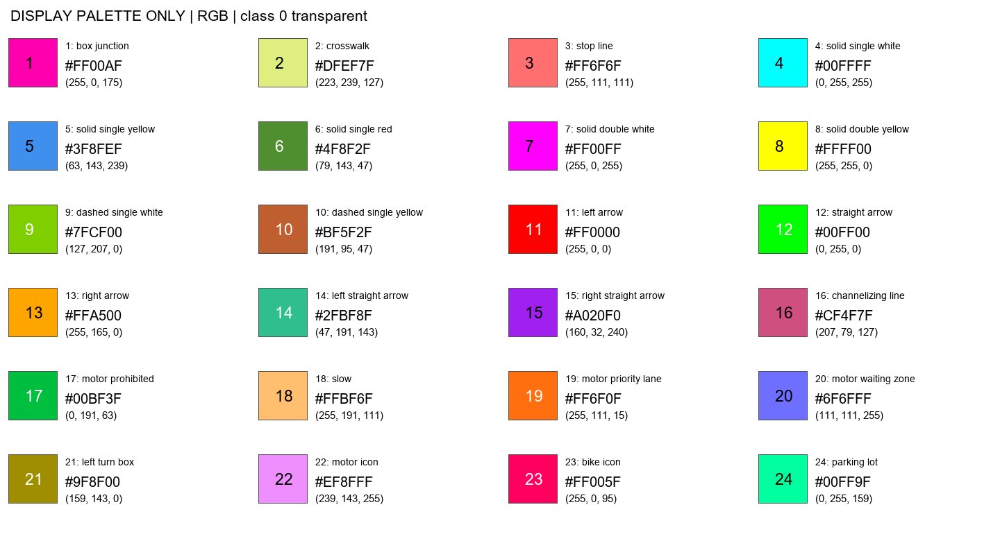

# 道路標線推論 使用手冊

台灣道路標線（25 類）的影片推論。輸入影片或影格資料夾，輸出標線疊色影片、每幀像素數與每類標線出現的時間區間。

只支援 `best_mIoU_iter_56000.pth`（SHA256：`75ccd13c8efe31a0c1a76f22ddcd3867ebdd606287af3c39ae43b6c589d96b36`），不能換成其他權重。環境安裝與需要準備的檔案請見專案根目錄的 `README.md`。

## 推論設定（固定）

- 滑動視窗 1024/683，FP32
- 時間平滑：對每幀的 softmax 機率做 EMA，`p_t = 0.7*p_(t-1) + 0.3*softmax(logits_t)`，再取 argmax
- 出現判定：類別面積至少佔畫面 0.05%，15 幀窗口嚴格過半才算出現；前 14 幀的投票結果留空
- 沒有額外縮放、跳幀、多尺度推論或 logit 偏置

## 使用方式

先依 [主 README](../README.md) 執行 `install.cmd` 安裝環境。模型與固定 374 張驗證資料直接包含於分支；安裝不執行驗證。接著自行執行 `verify.cmd`，通過後再跑影片。

影片使用入口：

```powershell
.\run_video.cmd 'D:\videos\your_video.mp4'
```

進階影格資料夾（在 `road_marking` 根目錄執行；`--fps` 請填真實 FPS）：

```powershell
& {
    $py = Join-Path (Get-Location).Path '.venv/Scripts/python.exe'
    $env:PYTHONIOENCODING = 'utf-8'
    $env:MPLBACKEND = 'Agg'
    $out = 'work_dirs/frames_' + (Get-Date -Format 'yyyyMMdd_HHmmss_fff')
    & $py -u tools/road_marking_infer.py --settings work_dirs/portable_settings.yaml `
      --input 'D:\your_frames_folder' --fps 30 --out $out --overlay
    if ($LASTEXITCODE -ne 0) { throw '推論失敗，請查看完整錯誤' }
}
```

30 只適用來源真實為 30 fps 的影格。影片使用其 FPS metadata；可變幀率影片的時間不是逐幀 PTS。解析度中途改變會停止。輸出必須是新目錄；影格自然排序且只讀第一層圖片。

安裝產生的 `work_dirs/portable_settings.yaml` 只將 FFmpeg 換成套件內的執行檔，其餘推論設定與原始 YAML 相同。所有入口仍檢查原 SHA、strict 載入、完整 val 驗證與指紋；沒有 skip/force。

## 設定檔

`configs/road_marking_infer.yaml` 放模型路徑、視窗、alpha、投票窗口與門檻、驗證資料路徑和疊色參數，預設值就是上面的固定設定。更改推論或時間參數後要重新驗證；只改疊色參數或 `configs/overlay_palette.yaml` 不需要重跑驗證。

## 輸出檔案

| 檔案 | 內容 |
|---|---|
| `pixel_counts.csv` | 每幀一列：frame、time_seconds、total_pixels、pixels_0～pixels_24 |
| `presence_timeline.csv` | 每幀 × 25 類：像素數、`raw_present`、`voted_present`、窗口內的出現幀數 |
| `events.csv` | 每類連續出現的區間，含 raw 與 voted 兩種版本 |
| `overlay.mp4` | 疊色影片（H.264，無音訊），僅在加 `--overlay` 時產生 |
| `summary.json` | 完成狀態、FPS、處理範圍（完整或子集） |
| `run_identity.json` | 這次執行的模型、輸入與參數指紋 |
| `overlay_display.json` | 這次實際使用的顏色與顯示參數 |

讀取時要注意：

- `raw_present` 是 EMA 之後、投票之前的面積判定，不是未平滑的神經網路輸出。前 14 幀的 `voted_present` 是空白，不是 0。
- `events.csv` 的 frame 從 0 開始，`start_frame`、`end_frame` 都包含端點。`end_time_exclusive_seconds` 是結束後的下一個時間點，單幀事件的長度為 1/FPS。影片結束時仍存在的事件會在結尾截斷，`closed_at_eof=1`。
- voted 事件不會往前補到前 14 幀。
- `pixel_counts.csv` 與事件檔都包含背景，使用時請篩掉 `class_id=0`。

## 疊色影片與色卡

- 顏色只讀 `configs/overlay_palette.yaml`，class 0（背景）不上色。顏色以區分度為優先，**不是依標線本身的漆色**。紅（11）與綠（12）對紅綠色盲不友善，請搭配畫面上的 class id 與圖例名稱判讀。
- 圖例列出該幀像素數超過畫面 0.02% 的類別，附 id 與名稱，位於右側的保留面板，不遮住道路。
- 每個類別的最大連通區域中心標有 class id。細長區域（寬度約小於 8 px）的填色透明度為 0.8，大面積區域為 0.35，並畫 2 px 的內側輪廓，保留底下原本的漆色。
- 圖例的門檻（0.02%）與事件的門檻（0.05%）不同。圖例上看得到某個類別，不代表投票後的事件成立。



只重新產生色卡：

```powershell
& $py tools/verify_infer_pipeline.py --settings configs/road_marking_infer.yaml --color-card-only
```

## 效果與限制

**分割準確率**（固定 374 張 val，單張 FP32 評估）：

| 視窗 | mIoU |
|---|---:|
| 512/341 | 58.66（58.65745） |
| **1024/683（本方案）** | **59.94（59.93841）** |

**閃爍**（同一段 172 幀、30 fps 的影片，線類像素在相鄰兩幀的變化比例，沒有做相機運動補償）：

| 設定 | 無 EMA | alpha=0.7 |
|---|---:|---:|
| slide 512/341 | 14.33% | 9.32% |
| slide 1024/683（本方案） | 14.15% | 9.72% |

**延遲：** EMA 的狀態轉換延遲約 1～3 幀（視覺估計，沒有逐事件的計時統計）。15 幀投票另外還要累積約 8 幀的新狀態，所以事件的實際延遲會比平滑本身更長，視面積與機率變化而定。

**已測過、不建議更改的設定：**

- **whole（整張推論）：** 同段影片閃爍約 10.80%，高於本方案的 9.72%，沒有找到 val 上的優勢。
- **slide 768/512：** 閃爍約 9.32%，但沒有這個權重的完整 val 評估，閃爍略低不能證明分割較準。
- **class 20、class 3 的 logit 偏置：** val 的 mIoU 只多 0.0058 個百分點，停止線召回卻從 82.72% 掉到 63.41%，不採用。
